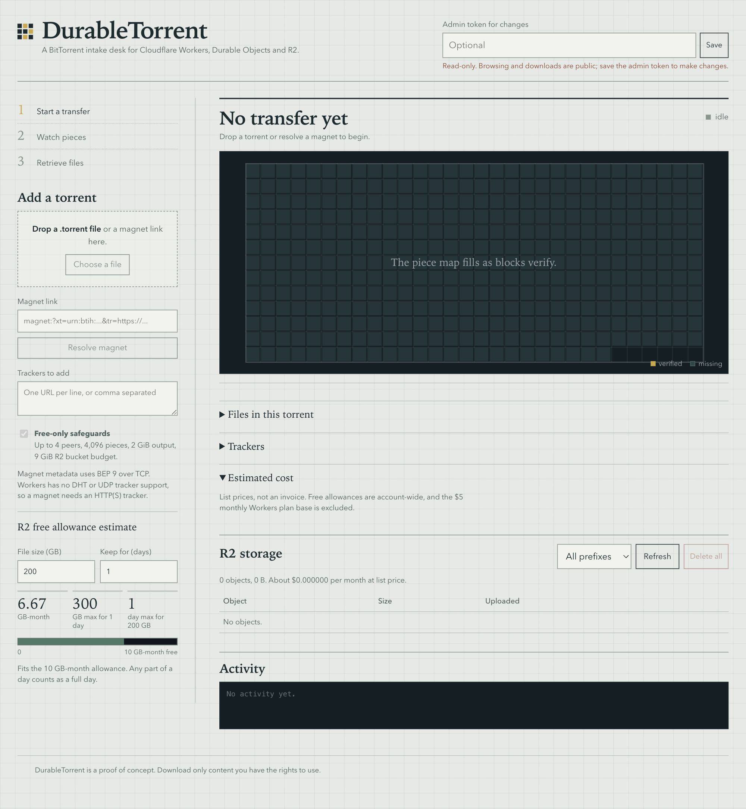

# DurableTorrent

**A BitTorrent downloader that runs on Cloudflare Workers, Durable Objects (SQLite) and R2.**

[](https://deploy.workers.cloudflare.com/?url=https://github.com/yukarikaname/durabletorrent)
[](https://durabletorrent.aliciaworks.workers.dev)
[](LICENSE)

> **Live demo:** https://durabletorrent.aliciaworks.workers.dev  
> Public read-only. An admin token is required to create, pause, or delete transfers.
>
> The Deploy button needs a **public** repository. This repository is private, so
> make it public or fork it before using the button.



## What it does

- Downloads a **selected subset** of a `.torrent` or magnet over outbound TCP.
- Parses bencode, resolves HTTP(S) trackers, speaks the peer wire protocol, and verifies every piece with SHA-1.
- Stages verified pieces in R2, then assembles the final object with resumable multipart upload.
- Shows a live piece map, peers, transfer speed and time left.
- **Free-only mode** (on by default) estimates R2 storage-time, shows the latest free-tier pickup date, and deletes output files automatically at expiry.
- Includes file selection for both `.torrent` and magnet sources, tracker management, R2 file management, and `DELETE /api/all`.

It **never accepts inbound connections and never unchokes a peer**, so it cannot seed.

## Quick start

```bash
npm install
npx cf auth login
npx cf r2 buckets create --name durabletorrent-blobs
npx cf deploy
```

Local development:

```bash
npx cf dev
```

Requirements: Node.js 22.23+ / 24.22+ / 26.12+ and a Cloudflare account. The
free Workers plan has a 10 ms CPU limit per invocation; the download tests in
this repo are small subsets. Workers Paid is recommended for real use.

## Architecture

```text
Worker ── fetch() ──► HTTP(S) tracker
  │
  └── DO stub ──► Durable Object (SQLite + Alarm)
                    ├── cloudflare:sockets ──► up to 6 TCP peers per wave
                    └── R2: torrent, staging pieces, final output, manifest
```

One Durable Object is one torrent session. Alarms run 8-minute download waves
and resumable finalization waves; state, piece bitmaps and progress live in
SQLite. Piece hashes are verified before a piece is staged to R2.

## Docs

- [Architecture and protocol details](docs/ARCHITECTURE.md)
- [HTTP API, read-only access and `cf` setup](docs/API.md)
- [Free-only safeguards and quota model](docs/API.md#free-only-safeguards)
- [UI design notes](docs/DESIGN.md)
- [Limitations and known gotchas](docs/LIMITATIONS.md)

## Validation

- `bun run scripts/selftest.ts` — 99 assertions.
- A Debian 13.8.0 netinst subset (8,388,607 bytes) completed through a real
  swarm and its SHA-256 matched the same range from `cdimage.debian.org`.
- Staging cleanup, free-tier expiry, `POST /expire`, `DELETE /api/all` and the
  read-only admin-token boundary were exercised on the live deployment.

## License

MIT. Copyright (c) 2026 Yukari Kaname. See [LICENSE](LICENSE).
